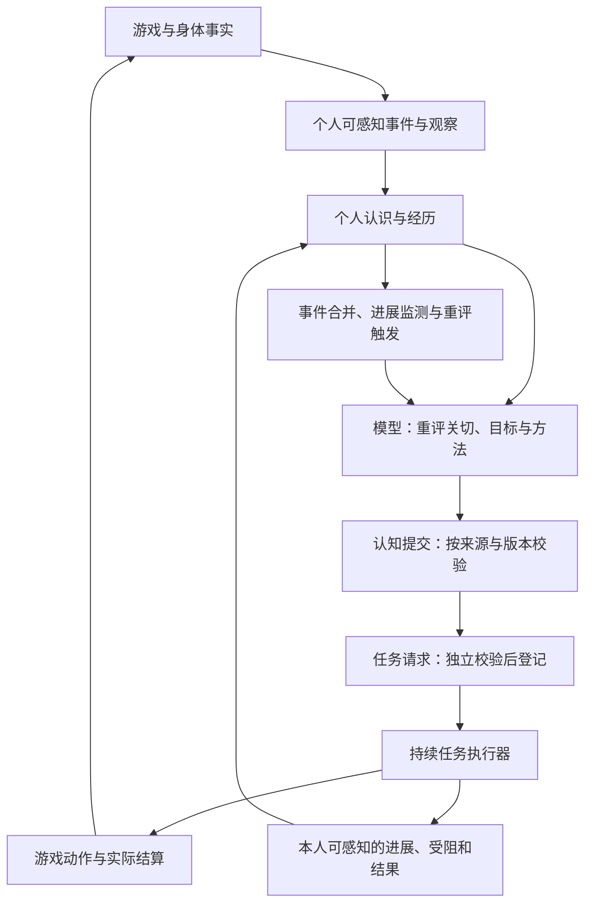

# AI 认知循环与目标调整设计 v0.1

> 本文维护目标设计与认知运行契约。用户要求人物能根据处境调整目标、从失败中改变方法，避免按具体生活场景堆行为分支。首版核心已接通，实际接口、验证及未完成范围以[当前状态](../development/当前状态.md)和[认知循环首版](../development/开发与验证.md#认知循环首版)为准，不将设计条目一并视为已实现。世界事实、人物属性、动作、调度和恢复分别引用原专题。

## 1. 本轮选择与边界

采用“持续个人认知状态＋事件触发重评＋有进展反馈的任务执行”。沿用 C# 游戏底座、共享模型、个人信息隔离、统一动作结算和额度控制。一次正常思考使用一次模型请求，各认知阶段不拆成多个模型服务。

仅增加提示词无法保证经历进入持续状态，也无法解决认知更新随动作拒绝丢失。多角色辩论或多模型串行会先增加延迟、费用和恢复状态。本轮先落实单个角色内部的状态与提交契约；不引入新的规划库或模型训练。

明确保留：强烈求生愿望、独立偏好、主观误判和独立回应。不规定职业、日程、共同生产目标或唯一正确的生活选择。程序提高紧急事实的可见性并要求重评，不根据需要分数直接替人物决定逃跑、攻击或交易。

世界必须提供真实的身体后果与可执行能力。当前简化饱食度归零不造成伤害、自然取食和工具起步未跑通，属于世界/能力接入缺口，认知设计不能把它们写成已具备。历史实现与一小时观察见[当前状态](../development/当前状态.md)。

## 2. 职责与个人状态

世界审计可保存完整伤害、库存和死亡因果。进入个人状态前仍经过感知过滤：感到受伤不等于知道未看见的攻击者或精确病因。观察面板只读取记录。

| 状态 | 内容与来源 | 更新规则 |
| --- | --- | --- |
| 感知记录 `percepts` | 本人实际看到、听到、身体感到及执行反馈；来源 ID、模拟时刻、范围 | 由感知入口登记，模型不能改写或伪造 |
| 个人认识 `beliefs` | 对地点、对象、资源、风险和方法条件的判断；依据、可信程度、最后获知时间、适用范围、修订关系 | 模型可修正；猜测、传闻与观察分别标记，永不变成世界真值 |
| 当前关切 `concerns` | 身体压力、感到的危险、承诺、兴趣等待考虑事项及来源 | 基础信号与模型提出的关切并存；模型可以延后处理，不能抹去尚在持续的身体信号 |
| 目标集合 `goals` | 本人的多个打算、来源关切、主观价值、依据及生命周期 | 选择、暂停、调整、放弃由本人提出；不自动继承为必须执行的命令 |
| 当前意图 `intention` | 本轮选定的目标、方法、预期进展、停止/重评条件、当前任务引用 | 一个人首版只有一个主要身体任务；暂停的目标保留本人已有进度 |
| 方法经历 `methodEpisodes` | 在什么已知条件下尝试了什么、实际得到什么、哪些预期没有发生 | 实际结果与个人解释分开；失败信息供之后的任务和目标检索 |
| 注意与重评 `attention` | 个人订阅、下次回顾、进展窗口、事件消费位置和待重评原因 | 程序检测已支持条件，模型选择关注与后续安排 |

这些是现有[个人状态](AI个体状态设计.md)的运行组织，不新建另一套身体、库存、人格或长期记忆真相。个人认知是所有记录的 owner；共享代码不共享私有经历。

地点认识仅覆盖实际观察到的区域和亲自经过的路径，记录“何时在什么范围没看见什么”。视野外、未探索、被遮挡均保留未知。记得资源存在不代表它现在仍在；别人告诉的位置带听闻来源。失效引用可以保留为历史地点，接触前必须重新观察。

## 3. 一次思考怎样组织

### 3.1 先构造与问题有关的工作区

输入包括：本次触发与新变化、当前身体感受、持续关切、目标及其依据、正在使用的方法与预期、任务实际进度、有关的个人认识和经历、实际收到的交流、已知能力摘要。

检索线索使用目标、方法、对象、地点、未解决疑问和本次变化，不只按最近时间或事件类别取几条。工作区必须给出：当前方法的相关反例、尚未处理的显著身体/危险信号、未完交接及当前任务结果。其余内容按实验中冻结的容量和稳定排序截断，记录省略内容类别与游标。

反复相同的执行结果可按“方法、目标范围、条件版本、失败类型”聚合，保留次数、首次/末次发生、累计真实成本和证据引用。聚合不能自动解释病因、替人物下结论，也不能让概括绕过遗忘恢复全部细节。工作集有界，长期保留与遗忘仍按[个人记忆规则](AI个体状态设计.md#9-记住检索巩固与遗忘)。

### 3.2 模型完成五项判断

1. **处境更新**：哪些新观察支持、削弱或推翻了自己的原判断；哪些仍不知道。
2. **关切与目标重评**：现在有哪些冲突的需要或打算；当前目标选择 `maintain / revise / suspend / abandon`，或选择另一个目标。首次可创建目标，完成必须区分本人认为完成与游戏核验结果。
3. **方法选择**：沿用、调整、换用、暂停等待或做一次有限的信息收集。说明依赖的已知条件和本次变化的实际参数。
4. **预期与界限**：本段行动预期取得什么可观察进展，允许付出多少时间/尝试，哪些本人可检测变化需要重评。
5. **提交决定**：提出认知差量和任务请求，给简短依据及来源，不要求输出完整内部思维链。

每次对有当前意图的正常回合，都显式表达目标取舍，不把“继续当前目标”设为省略时的默认值。维持目标可以合理，但应回应本轮相关的新证据。程序校验来源和协议，不声称能判断理由是否诚实或策略是否聪明。

目标重评针对处境。没有新语义问题、任务仍在预期范围内时，由执行器继续，不为每一步转向制造一轮完整反思。

### 3.3 目标、方法、任务分开

目标生命周期为 `active / suspended / achieved / abandoned`，每次变化有目标 revision、来源、决定 ID 和任务去向。`achieved` 中分别记录本人判断及可核验完成条件，不能用主观完成领取产物。首版只允许一个 active 的主要身体意图，其他目标可处于 suspended；协议不接受同时激活多个互斥身体任务。

方法是本人准备怎样实现目标；任务是执行器当前正在做的有界过程。相同目标可以换方法，紧急重评可以暂停目标，恢复时重新核对前提，保留已结算成果。外部消息、旧承诺或沉没投入不能自动使一个目标永久优先。

## 4. 失败怎样改变方法

### 4.1 先区分失败发生在哪一层

| 反馈类别 | 本人可得到什么 | 框架处理 |
| --- | --- | --- |
| 世界内执行受阻 | 实际接触、未到达、数量不足、部分交付等可感知结果 | 执行器在本人许可范围内恢复，耗尽后形成方法经历与重评 |
| 预期未实现 | 本段实际进展、已观察范围、耗时/成本与原预期的差异 | 目标/方法重评；不把“没看见”扩成“世界上没有” |
| 语义条件改变 | 目标不再可见、自己受伤、实际收到拒绝或新消息 | 更新个人认识，按订阅或基础注意触发重评 |
| 技术或协议错误 | 仅技术诊断；动作有没有实际发生另记 | 网络失败、非法参数、过期姿态不自动写成“这种材料不可用”或人物性格变化 |

有部分效果时先保留实际效果，再记录剩余差额；一次失败不代表整个目标失败。相反，动作成功也不代表目标取得进展：不断转向可以成功，但搜索可能没有增加新的可见区域或资源线索。

### 4.2 进展与方法变更有结构

每个任务声明可核验进展，例如进入新观察区域、接近已知目标、取得实际数量、加工完成量或收到等待的事件。进展窗口使用模拟时间或完成的尝试数，预期应与已启用能力的实际耗时相容。没有可核验条件的文字愿望可以保留，但不能被包装成可自动完成的任务。

无进展达到窗口时，生成包含“期待、实际、条件、次数、累计成本”的重评材料。程序不选择新的生活目标。模型须在改变方法、重评目标、继续收集信息或有限等待中作出明确选择。

首版已将实际三维覆盖、跨方法活动、近期伤害与当前方法代价并列输入，并关联本人的到访和受伤位置；身体、当前可见运动及在途期间的视觉经历由独立采样保留。模型可预先选择本人体感条件和有界后续分支，网络等待期间由执行器监测触发，沿用授权与效果保存边界。字段、容量和验证见[通用感知与运动执行](../development/开发与验证.md#通用感知与运动执行)。这不是完整空间信念、因果学习或安全路线规划器，不能用覆盖增长抵销身体恶化。

方法签名由能力/方法版本、目标或已知范围、选择条件、实际策略参数与停止条件规范化生成。纯改标题、换同义词或增加计划版本号，不构成方法变更。只以失败类型或对象名字做全局黑名单也不成立。

相同条件、相同方法重复零进展时，不允许无限自动重启。继续相同方法必须说明新的依据或有界等待理由，并设置下一次可检测的变化/截止；仍会消耗真实时间与资源。达到协议修复上限仍无法形成合法有界决定，按认知协议故障保存暂停，不由宿主替人物选成功方案。

方法失败的适用范围随证据保存：某条接近路径失败，不等于该资源永远不可取；某次被拒，不等于所有人不可信。新线索、环境变化或新的方法条件可重新尝试，并记录改变依据。

### 4.3 经历成为之后可用的方法知识

经历包含 `goalId / methodVersion / taskId / conditions / expectation / actualProgress / perceivedOutcome / interpretation / evidenceRefs`。游戏提供实际结果，模型可提出“什么条件下值得再用”的判断，作为个人认识保存。

共享基础动作与参数化执行代码；本人从实践或实际收到的交流获得的方法知识单独持有。模型可以用已有动作提出新组合，经编译、授权和实际效果核验后执行。一次自称“学会”不授予配方、工具或熟练度，教学也不复制对方未说出的经历。

## 5. 与执行器和能力接口的契约

意图交给执行器时，必须有：所属人与决定 ID、目标 ID/revision、方法 ID/version、本人已知目标或搜索条件、范围、资源与时间界限、前提、预期进展、完成/停止条件、获准局部恢复和下一重评条件。

通用组合包括搜索、接近、取得、按已知规则加工、交接、等待。目标选择条件基于本人已知属性及实际观察，不能查询隐藏资源或用引擎真值列出必定成功的办法。具体物理作用仍须有真实实现；不支持的操作明确返回能力边界，不能自动补给、复活或生成产物。

能力描述按同一结构登记：可表达作用、个人所知前提、实际执行约束、目标引用规则、持续控制、可感知反馈、进展与结果、取消及恢复。由这些契约导出可用能力；避免由“觅食者/木工模式”的白名单决定整个认知接口。初始知识许可、亲身认识和引擎真实能力分别核对。

执行器负责在已授权任务内持续观察、绑定目标、接近、局部绕障、检查效果和有限恢复。出现新的交易/攻击/逃离选择要交回本人。人物选定离开某个可感知威胁后，控制器可持续完成有界离开与重新观察，不让模型逐帧报角度。

动作请求引用稳定的已知对象、最后观察锚点或获准搜索范围。接触前复核实际条件；不可把旧的“右转 90 度”直接套到新朝向。局部几何变化可在授权范围内重算控制量；人物失去目标的感知后，不能暗中追踪其真实位置。旧参数无法安全重新绑定时拒绝该动作请求，并反馈给认知层。

身体压力必须经实际身体机制产生，伤害需保存审计因果并提供本人能感到的变化。单个粗分档未变化不能成为漏掉持续恶化或新伤害的理由。各项具体身体作用的实现仍由[身体专题](AI身体与生命周期设计.md)维护。

## 6. 输出、校验与认知/行动分别提交

### 6.1 输出是差量

首版回包包含三部分；下表表达设计职责，实际可调用字段与限制由[当前接口](../development/开发与验证.md#认知循环首版)维护：

| 部分 | 必须表达 |
| --- | --- |
| `understandingPatch` | 本轮需要变化的认识/经历解释；输入证据引用、写入对象预期版本。无变化可为空 |
| `deliberation` | 目标取舍、新/维持的意图、方法、简短依据、预期进展与重评条件；显式说明本轮显著关切如何处理 |
| `taskRequest` | `continue / submit / replace / stop / none`，依赖的目标与方法版本、支持的任务参数；可没有新动作 |

无动作的回合仍可形成有效认识、暂停目标或等待；动作参数合法不代表认知更新合法。工具说明只描述能力和协议，移除以工作台、特定工具或特定伙伴为中心的生活指导。场景目标、配方和初始资源只能来自冻结实验配置或本人的实际经历。

回包解释仅作为人物判断。`reason` 不是事实证明；程序验证可访问来源、引用、字段与版本，不用另一模型为每轮裁判，也不记录未输出的内部思维过程。

### 6.2 先保存个人已经经历的内容

合法感知与本人实际任务结果在模型调用之前进入个人事件收件箱，保存消费位置。模型没有返回 `remember` 不会使正在使用的近期结果立即消失；哪些经历长期保留、概括与遗忘仍遵守个人记忆规则。审计锚点存在不赋予角色永久完美回忆。

### 6.3 一次决定分成有依赖的提交组

1. 校验所属人、实验、协议与精确输入关联；计费按实际请求结算，不取决于决定是否采用。
2. 将 `understandingPatch` 按被修改的认识项组成提交组；将目标、意图和相互引用的方法修改作为同一个 `deliberation` 提交组。组内要么全接受，要么全拒绝。未写字段保持原值，不能用整份旧状态覆盖当前状态。
3. 每组只引用输入中可访问的证据及已存在认识。写入检查该项/目标的 expected revision；新增项 ID 由 `decisionId + groupId + localId` 稳定派生。组内局部引用一次解析，禁止引用另一未接受组的新条目。若 deliberation 需要某个认识更新，显式列出它依赖的组；依赖被拒则不采用该 deliberation。
4. `taskRequest` 绑定接受后的目标/方法 revision，独立复核任务、位置、资源和当前可感知条件。动作被拒仍保留已接受的认知组；认识/目标组被拒则不得执行依赖它的新任务。旧任务是否继续，依据同一 deliberation 已提交的任务授权去向，不能由新任务是否接受倒推。
5. 记录逐组采用/拒绝、依赖关系与动作请求去向，再在统一阶段登记待启动任务。来源事实、认知变化和待启动身份共同持久化后才发布；尚未完成的动作只能登记为意图。

因此，位置变化拒绝一次接近请求，不会抹去已合法接受的“这条路没有进展”的认识。任务后来失败也不能撤回本人已经产生的判断或重做已经发生的效果。

### 6.4 变更意图时，旧任务怎样处置

本设计选择把旧任务的执行授权与新任务能否启动分开。存在当前任务时，deliberation 必须显式给出 `taskDisposition`，包含任务 ID、预期授权 revision 和以下一种去向；它与目标/意图在同一组提交：

- `retain`：继续原授权。只允许原目标仍 active、原方法及授权范围未改变；单纯更新认识不会强制中断任务。
- `suspend`：暂停旧目标并保留可恢复任务工作区，停止后续步骤，在能力允许的边界停止当前动作。再次执行必须经本人重新选择目标并核对现场。
- `revoke`：撤销本次任务授权，禁止继续发出旧步骤，不自动恢复；放弃旧目标或撤换旧方法时必须使用，也可保留上层目标而结束本次执行。

授权 revision 只在授予、改变范围或撤销授权时变化，不因身体每帧移动或普通步骤进展递增。输入中的旧任务已终结且未出现替代任务时，停止去向可按该任务身份记为已满足；若已有不同的新授权任务，旧 deliberation 不得停止它，相关组按版本冲突拒绝。

暂停/撤销记录先与认知组共同持久化，旧执行器在后续允许的动作阶段消费同一停止标记。已经发生的效果保留；不可撤回的世界过程继续按游戏规则结算，但不得因此启动旧方法的下一步。能力契约定义最早可停边界、释放的身体占用及可保存工作区；没有暂停恢复能力的方法只支持 revoke，不能虚报已暂停可恢复。

新任务采用 `replace` 时仍须验证上述去向及新授权。新任务被拒，已经接受的 suspend/revoke 仍有效，新意图标记为 `awaitingTask`，不自动回滚或复活旧任务。新任务被接受但旧动作尚未释放身体占用时，保持待启动，在停止边界后再复核；不能两个互斥任务同时推进。全部去向、停止消费标记、占用状态及新任务等待关系随检查点保存。

迟到响应不自动重放主观修改：同一认识项已有新 revision 时，拒绝旧覆盖并给下次重评提供采用结果。即使旧内容有合法历史来源，也不能在更晚时刻伪装成最新状态。无关认识项可以独立提交；显著新事件使旧目标判断失去适用前提时，拒绝该 deliberation 与其依赖任务，而不删除既有感知。

每组及动作请求使用独立去重键，写入采用结果和来源 `decisionId`。恢复时重用原输入、原响应及已保存采用结果；不得重新解释同一回包、再次增加失败次数或再次记账来决定哪些组采用。提交中断的恢复由[存档专题](AI存档恢复与历史回放设计.md)中的共同检查点契约承接。

## 7. 何时重评、怎样避免忙等与摇摆

触发来自实际感知变化、任务语义前提失效、实际无进展窗口、本人安排的回顾、承诺/等待结果和基础思考机会。只做身体数值粗分档或每个原子动作结束触发都不够。关联同一目标/方法的多个理由合并，事件有稳定 ID 和消费游标。

紧急信号只提升本人可感知变化的处理优先级，例如新伤害、疼痛快速加剧、实际观察到的快速接近。程序不能根据隐藏动物意图或全图危险标签强制逃跑。紧急重评必须带入新事实、当前意图及其实际进度；模型明确选择处理、延后或维持，并记录依据。

已有在途请求时，新事件先进入缓冲并标记相关 deliberation 需重评。首版每人最多一个网络在途请求：请求正常结束或取消/超时进入既有账本处理后，优先安排包含最新事件的新回合，不通过不停取消重发获取无限并发。旧回包的无关认识更新仍按第 6 节校验；被新事件推翻适用条件的任务不可启动。取消的发送费用未知时继续保留负债。

在途期间世界是否推进、人物何时具有模拟中的反应机会，沿用[时间专题](AI时间推进与调度设计.md)的冻结策略。本设计不把网络延迟当成认知速度，不凭增加紧急队列宣称已经实现公平反应时钟。授权动作可继续；只能因自身物理约束或本人已经接受的停止条件停下，不由网络等待触发新的生活策略。

避免两种循环：持续同一信号用触发沿、合并和回顾窗口处理；没有新证据的改意不制造免费动作重启，旧任务的实际投入保留。模型仍能改变主意，程序不规定必须坚持几轮或总是选择最高分目标。

首版建议工作集上限：8 个当前关切、8 个待考虑目标、32 条相关认识、16 条方法经历摘要和一个主要身体意图。它们是待验证的容量参数，不是长期记忆总量或心理学常数。合并摘要不能挤掉未处理的紧急来源和目标依据；强制部分超限时先采用更小的合法输入/技术暂停，不能静默丢弃重要事实。

重复零进展的默认重评阈值建议为同方法同条件连续 2 个完整窗口；每个窗口长度由任务能力及本人的有界预期提供。格式、越权或未知协议字段等协议错误最多允许 1 次额外模型修复请求，先预留并计费，仍失败则保存暂停。合法回包因现场变化或版本冲突不采用，属于正常再观察与重评，不按格式错误重试整包；网络失败仍按既有计费、未知负债与退避契约处理。上述容量、阈值及修复策略均须在新实验配置中冻结，不能在运行中为改变结局调整。

## 8. 保存、实现边界与替换顺序

检查点额外保存个人认识及 revision、关切、目标/意图生命周期、方法签名与经历摘要、进展窗口与真实成本、事件消费游标、待重评标记、精确输入、响应、各提交组采用结果、依赖关系及已登记任务。认知状态变化和世界动作采用同一个可恢复阶段边界，原子动作去重沿用现有机制。

旧 `personalPlan` 的文本可迁入“历史打算”，不能自动当作已有方法、已核验完成条件或成功经历。旧存档按旧认知配置继续，或从保留的世界/账本锚点创建有来源的新实验分支，再做显式迁移和首次重评。不在原实验里悄悄替换思考机制，不遗失已计费用和未决负债。

实现职责建议如下，类名供开发定位，不要求照名创建文件：

| 职责 | 现有入口与改动边界 |
| --- | --- |
| 个人认知状态与输入 | `ActorCognition`、`ActorCognitiveContext` 接入认识、关切、目标及相关经历工作区；保留状态与模型传输解耦 |
| 重评与差量提交 | 从 `ActorCognition.CommitObservation/InstallTurn` 分离逐组认知提交、依赖校验和动作采用结果；复用既有来源校验 |
| 执行反馈与有界任务 | `ActorTaskExecutor`、`ActorTools` 提供通用任务、实际进展与受阻反馈；已有原子动作继续统一结算 |
| 能力与感知 | 替换以生产角色为中心的观察/提示；接入统一能力契约及本人感知，不扩成全知接口 |
| 调度和存档 | `WorldCognitionScheduler` 合并事件和重评原因，保存提交游标、窗口及局部 revision，继续使用累计额度机制 |

替换顺序按通用契约组织：先建立可感知事件与持久认知状态，再实现目标/方法重评及分组提交，然后接持续任务与能力描述，最后做新旧分支对照与开放运行。不要先加一组生活剧情再补它专用的认知字段。每一步只声明已实现、已验证的部分。

## 9. 验收：同一套机制跨处境复用

验证矩阵的主要维护位置为[测试专题](AI测试验收与演化证据设计.md#认知循环与目标调整验收)。固定响应测试验证信息、版本、进展、提交与恢复契约；真实模型验证人物是否实际使用新证据改变判断与方法。前者通过不等于后者通过。

变更资源类型、地形、可见线索、他人回应、干扰时点、人数与种子，复用同一接口和执行器；允许真实模型选择不同目标。比较可感知信息相同而隐藏事实不同的对照，输入、唤醒与菜单不得泄漏差异。

报告目标取舍及来源、方法签名与实际参数变化、预期/实际进展、同条件零进展重复、有效认知更新在动作拒绝后的保留、每个人获得的重评机会、请求及费用、重复结算与恢复差异。单纯改了计划文字、不再报错、模型说“我反思了”、人物存活或做出某件成品，均不能单独作为框架通过的证据。

开放观察应冻结配置并保留全部登记运行。故障归到感知未提供、记忆未取用、模型未改变判断、执行未完成或世界作用缺失，避免把所有失败都归到模型。死亡和冒险可以发生，缺乏因果记录、无限空转、认知随动作错误丢失则属于明确的工程问题。
