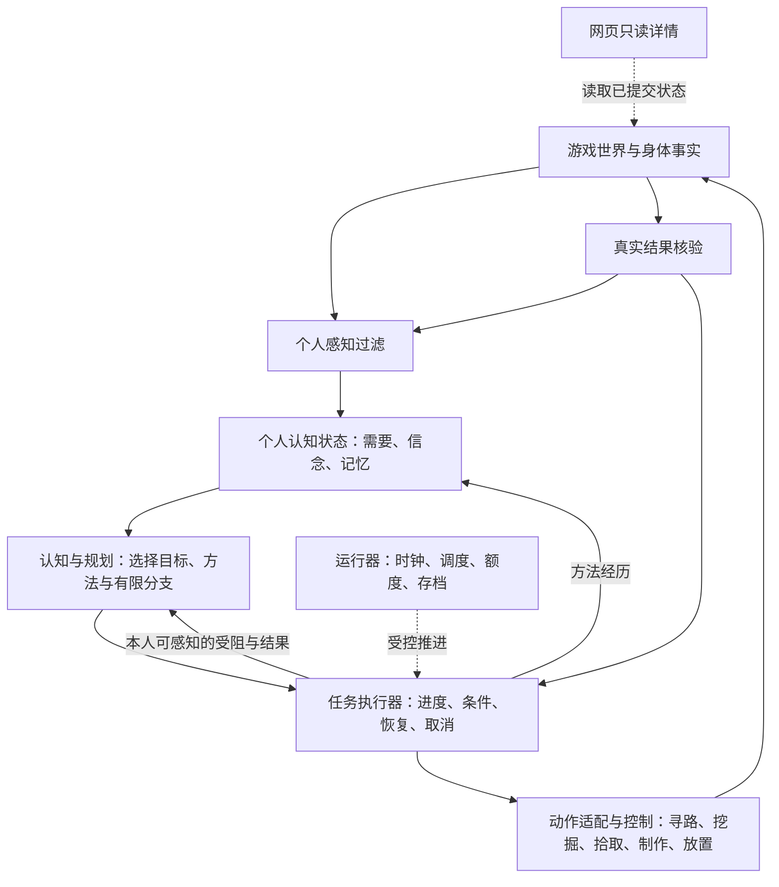

# 无人机、机器人与具身智能架构借鉴

> 调研日期：2026-11-07。面向 Windows 本机上的 Survivalcraft 多人物实验。本文区分来源事实与项目建议；候选架构尚未实现，不更改当前已确定的模拟时间、信息隔离、预算暂停和只观察规则。

## 1. 研究结论

建议将现有五层职责落实为三个主要执行模块：个人认知与规划、任务执行器、游戏动作控制。个人信念/记忆与运行器控制分别作为跨模块服务。五层仍可用于解释抽象程度，不需要五个模型、五个线程或五个服务。

研究重点是借用任务持续执行、局部恢复、分频更新、结果核验、技能积累与有限感知等机制。机器人遵循外部任务的目标来源与本项目不同；人物须从自身需要、偏好与经历形成打算，不能移植成统一服从指令或最大化文明产出的群体。

## 2. 公开来源与适用取舍

### PX4：分频模块、设定值与异步消息

来源事实：PX4 将导航、控制、估计与驱动分为组件，使用 uORB 异步发布订阅。导航模块与高频传感/控制模块的更新率不同，工作队列也限制阻塞操作。伴随计算机可承载更高层任务。

借用：高层提交有身份和版本的目标/设定值，底层根据反馈持续控制；局部变化触发相关组件，不让全部人物在每个物理帧调用模型。

边界：uORB 是进程内通信机制，不能等价于本项目的个人知识共享。飞行器失效保护可自动返航，本项目不能因此自动替人物选择逃跑、合作或保证存活。真实无人机不能暂停物理世界；本项目的模型等待和模拟时钟契约仍独立维护。

[官方软件架构](https://docs.px4.io/main/en/concept/architecture) · [飞控与伴随计算机](https://docs.px4.io/main/en/concept/px4_systems_architecture)

### Nav2：行为树、进展检查与分级恢复

来源事实：Nav2 用行为树协调路径计算、路径跟随和恢复；节点区分执行中、成功与失败。局部恢复仍失败才进入更高范围的恢复，并限制重试次数；规划频率也可与控制频率分开。

借用：复合任务保留正在运行的步骤；局部绕障或有限重试先由执行器处理；没有进展、目标失效或重试到界时向认知层报告。低层一次失败不等于需要重做全部计划。

边界：Nav2 的恢复节点清理的是导航代价地图，不是删除世界障碍。不能照搬成给人物清除方块、清空记忆或重置物资。行为树节点正在运行不等于动作具有跨进程恢复保证，需要另外保存游标与已发生效果。

[行为树节点](https://docs.nav2.org/rolling/getting_started/nav2_behavior_trees/nav2_specific_nodes/nav2_specific_nodes/) · [完整恢复流程](https://docs.nav2.org/rolling/getting_started/nav2_behavior_trees/detailed_behavior_tree_walkthrough/detailed_behavior_tree_walkthrough/)

### PLEXIL：规划与执行之间需要专门的执行器

来源事实：PLEXIL Executive 加载并运行计划/库，通过适配器向外部系统发命令、查询状态，并向外部提供执行状态通知。这是经典执行架构参考，不作为新发布模型介绍。

借用：模型提出任务以后，由执行器负责真实进度、命令状态、取消和结果反馈；模型输出计划不能同时认证计划已执行。执行器与具体游戏组件通过适配器隔离。

边界：本项目不必引入 PLEXIL 的 C++ 运行时，可在 C# 中实现所需契约。通用执行器也不自动知道角色应该追求什么。

[项目执行器文档](https://plexil-group.github.io/plexil_docs/PLEXILExecution/PLEXILExecutive.html)

### Gemini Robotics ER 2：高层编排与持续结果检查

来源事实：2026-07-30 发布资料将 ER 2 用于多步骤任务编排，可将导航 API、动作模型等声明为工具；同时强调进度跟踪与完成判定。流式交互支持执行期间持续更新判断。

借用：把动作做成有明确输入、状态与结果的工具接口，依据真实执行反馈调整后续步骤；明确“命令返回”“动作停止”“目标达成”是不同事件。

边界：这些是提供方资料中的能力及评测，不能直接证明本项目会获得同等可靠性。游戏能从引擎核对的结果优先直接核对，不额外付费请模型判断背包是否增加。流式输出仍为候选，未完成或未经校验的片段不能提前产生世界效果；当前世界等待机制不因此自动改变。

[发布与架构说明](https://blog.google/innovation-and-ai/models-and-research/google-deepmind/gemini-robotics-er-2/) · [模型卡](https://deepmind.google/models/model-cards/gemini-robotics-er-2/)

### GR00T N1：高层理解与低层动作的不同节奏

来源事实：2025 年公开的 GR00T N1 使用双系统架构，将视觉语言理解与动作生成结合。

借用：语义决策和密集动作不必使用同一种算法或同一更新频率。

边界：机器人需要学习身体控制，游戏已有移动、碰撞和操作组件。首轮复用游戏控制，不为借鉴架构就训练视觉语言动作模型、引入扩散动作网络或购买训练算力。

[研究原文入口](https://research.nvidia.com/publication/2025-03_nvidia-isaac-gr00t-n1-open-foundation-model-humanoid-robots)

### Isaac Lab：环境接口与物理/策略分频

来源事实：Isaac Lab 把环境观测、动作及事件等职责拆开；环境提供观测并执行策略动作，物理步长与策略步长可以不同。

借用：游戏适配层明确导出个人观测、接收动作、返回真实结果；每帧推进游戏控制，不为每帧重新生成高层决定。隔离测试可以复用同一个观察/动作契约。

边界：仿真器完整状态不自动成为角色可知信息。训练环境的重置、奖励与终止机制不移植为正式世界的投食、复活、文明分数或自动重开。策略复用相同动作期间仍须监测中断和资源变化。

[环境接口与时间步长](https://isaac-sim.github.io/IsaacLab/main/source/api/lab/isaaclab.envs.html)

### OmniGibson：物体状态与声明的近似规则

来源事实：OmniGibson 用物体状态表达空间关系与温度等属性，也用显式转换规则表达切割、混合等复杂过程。

借用：建立对象属性、状态变化与实际作用的通用接口，复用游戏现有方块和配方。需要增加新作用时用可检查规则及真实投入输出，避免为每个角色写特殊剧情。

边界：高质量机器人仿真也并非从基本物理自然推导所有生活过程。公开规则可说明近似边界，不能据此宣称任意新技术已能结算。本项目不迁移到 OmniGibson，也不把外观真实当作物质守恒证据。

[物体状态](https://behavior.stanford.edu/omnigibson/object_states.html) · [转换规则](https://behavior.stanford.edu/omnigibson/transition_rules.html)

### SayCan：语言上有用与当下做得到分开

来源事实：SayCan 将语言模型对技能用途的评估与技能可执行性的价值估计结合，用于选择步骤。这是 2022 年的经典工作。

借用：计划里合理的动作，仍要检查距离、工具、材料、身体和目标变化。区分人物对可行性的判断与游戏开始/执行时的实际检验。

边界：不能根据隐藏真值给人物列出必定成功的动作菜单。游戏可以拒绝越权操作；有效但条件不成立的尝试须经合理的感知与反馈，让角色可能误判，而不是免费知道隐藏资源和毒性。

[作者项目与论文](https://say-can.github.io/)

### Voyager：执行方法可以随经验积累

来源事实：2023 年 Voyager 在 Minecraft 中结合自动课程、可执行技能库和环境/错误反馈迭代，方法可以组合与复用，不要求更新基础模型权重。

借用：个人将试过的步骤保存为有版本、有条件、有反馈证据的方法，之后选择复用与改进。一次思考支持较长的具体行动，不重复从头规划。

边界：其最大化探索的自动课程不是本项目所有人的共同目标。不给每个人注入相同的升级任务。自由生成代码也不直接移植；人物只生成受限的动作组合，不取得任意 C#、宿主文件或 shell 权限。共享执行实现不共享私人技能，传播仍通过真实接触。

[作者项目与论文](https://voyager.minedojo.org/)

### 内稳态动机研究：需求来自内部状态

来源事实：2014 年内稳态强化学习研究把内部生理状态及预期变化纳入动机建模；其形式模型讨论维持生理稳定与学习策略的联系。

借用：游戏中的食物、疲劳、体温和伤害产生持续身体后果，人物根据感受与经历形成需要，而不是按时接收采集任务。对未来需要的预期可以支持储备与计划。

边界：该形式模型不是完整的人类心理理论，不足以推出诚实、偷懒、权力和所有社会选择。首轮不强制引入强化学习训练或唯一奖励函数，仍让独立偏好、关系与记忆参与判断，不把数值最高的需要直接编译成人生决定。

[原始研究](https://elifesciences.org/articles/04811)

## 3. 项目候选结构：三条主要执行职责与两个跨模块服务

- 认知与规划负责价值选择，通常一次模型请求可合并目标、方法、交流、记忆更新和后续回顾；不是五层各调用一次。
- 任务执行器维护有界任务图/树，采用少量行为树式组合与动作状态机；不手写每个人的日程或整棵人生行为树。
- 游戏控制先适配现有组件。线程中的模型或数据库回调不直接改变世界，动作仍进入统一启动与结算入口。
- 个人认知状态与任务工作区按身份隔离；内部事件总线传递受控记录，不把全部事件广播到全部人物上下文。
- 运行器控制是技术服务，处理费用、磁盘、故障与恢复，不充当全体人物的中央大脑。

现有五层的“长期目标/任务规划”可同属认知模块，“技能执行/具体行为”由任务执行器与动作适配器承载，“底层控制”由游戏处理。这里调整实现边界，不把新方案当作用户已确认的全部技术细节。

## 4. 执行器需要的最小契约

| 部分 | 必须定义 |
| --- | --- |
| 来源与范围 | 人物、决定/目标、方法版本、已知目标引用、允许搜索与资源范围 |
| 条件 | 开始前提、必须持续满足的条件、真实完成条件、停止及失效条件 |
| 生命周期 | 等待、执行中、受阻、成功、失败、取消；技术暂停另存，不当作角色主动放弃 |
| 进展 | 已完成量、上次有效进展的模拟时刻、实际成本、当前步骤和部分结果 |
| 恢复 | 有限重试、本人已经允许的替代分支、超时/无进展后的向上报告 |
| 一致性 | 稳定任务/动作身份、取消后的迟到结果、步骤游标和效果去重；共同检查点保存 |
| 反馈权限 | 个人只读实际感知到的内容；引擎审计可记录真实原因，但不能自动注入本人判断 |

首轮组合节点建议只做：顺序执行、按条件分支、有界重复、局部恢复、停止/取消。并发只在已有动作兼容规则允许时开放，不能以两个子任务并行获得双倍身体能力。

HTN 可用于展开本人已掌握的分层方法；GOAP 更适合已有有限动作效果与状态的搜索。两者暂不同时引入。全局效用排序不能替代人物的语义判断；行为树也不负责决定谁诚实、谁劳动。

## 5. 一条具体执行链

人物实际感到饥饿并想补充食物，选择自己知道的食物来源。认知层提交有限任务，执行器展开寻找、接近、取得和进食。移动受阻先在允许范围内重算路径；到达失败、食物被取走或方法失效，则保留已发生成本并报告。取得命令返回后仍检查真实物品是否进入背包；进食后再核对游戏身体后果。

遇到另一人占用资源时，执行器不能自行选择交易、偷窃或攻击。本人可改变目标、请求、等待或争夺，对方独立回应。新判断进入新的正常决策，不能在同一次模型请求里替双方作决定。

角色觉得“我做到了”与引擎核验的完成条件分开保存。技能入库可以记录成功与失败经历，实际验证仅证明已测范围，不保证将来必成。

## 6. 与当前设计相比，优先细化什么

1. 在已有目标/动作协议之间明确任务执行器，补进展、取消、有限恢复与真实完成检查。
2. 分开固定基础动作实现和人物可学习的方法。后者有来源、版本、适用范围，未经传播不共享。
3. 把角色信念与世界真值的权限落实到规划、检索、寻路和失败反馈，不只限制最终提示词。
4. 保留游戏物理步、执行检查和语义决策的不同节奏；具体频率经测量冻结，不照抄飞控 Hz 或为了凑并发延迟人物反应。
5. 先用 C# 游戏接入验证这些契约，再评估是否需要更复杂规划库。ROS 2、PX4、Isaac Lab 与机器人模型均不作为本项目必装依赖。

本轮不会因机器人流式交互而改动既定的全局模拟等待、不因掉线改用另一人格，也不把机器人群共享地图直接变成人物共享知识。若后续考虑改变这些机制，应单独说明语义、因果、公平、费用和恢复影响，再建立新实验配置。

## 7. 最小验证场景

- 一次高层决定驱动许多控制步；没有新语义问题时不反复请求模型。
- 路线受阻可局部恢复，恢复有上限；遇到利益冲突必须回到本人判断。
- 原始操作返回成功但没有实际物品变化时，不标记任务完成。
- 部分取得、工具损坏、取消、迟到模型结果及中途退出后恢复，不复制效果或重复扣资源。
- 两人各有私人方法；共享控制代码不使其读取对方记忆，实际教学后才可能获得方法。
- 本机玩家飞离营地后，固定决定仍能驱动远处 AI 完成任务。网页开关只影响展示。

这些是候选验收范围，尚未执行。稳定的通用原则可在后续设计细化时并入[行动专题](../design/AI个体行动与模型交互设计.md)，本页保留来源和取舍，不替代[当前状态](../development/当前状态.md)中的实现证据。
